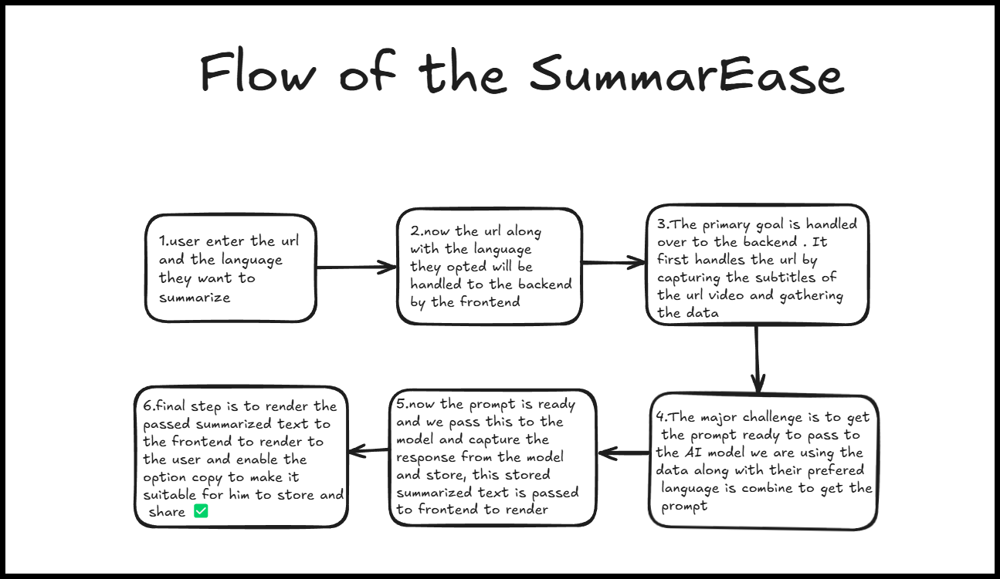

# SummarEase  


SummarEase summarizes YouTube videos with accessible captions and public blog or article pages. Choose a language and get a concise, source-grounded bullet-point summary.
## Video URL
[Demo And Explanation](https://drive.google.com/file/d/1gCU0Ley8Z5RI969KjDsKXiNm567U7dyr/view?usp=sharing)

## Features  
1. **Summarizes YouTube videos and public HTML articles.**
2. **Generates grounded bullet points in the selected language.**
3. **Saves successful summaries to the signed-in user's MongoDB history.**
4. **Filters history by date, language, and source type.**
5. **Lets users view, copy, download, and delete saved summaries.**

## Flow of the Application  
1. **User Input**: The user chooses a source type, enters a URL, and selects a summary language.
2. **Frontend Handling**: The frontend sends the URL and language preference to the backend.
3. **Backend Processing**: The backend retrieves YouTube captions or extracts readable text from a public article.
4. **Prompt Preparation**: The extracted data is combined with the preferred language to form a structured prompt.
5. **AI Processing**: The model generates concise bullet points in the selected language.
6. **Rendering Output**: The result is displayed and saved to the user's database history.




## Project Structure

```text
client/src/
  components/       Shared UI, layout, routing, and examples
  contexts/         React context providers
  pages/            Route-level screens
  utils/            API client and helpers
server/src/
  config/           Database connection
  controllers/      HTTP request handlers
  middleware/       Authentication middleware
  models/           Mongoose models
  routes/           Express routers
  services/         Application and external-service logic
  utils/            Token and other helpers
```

## Installation & Setup

Prerequisites: Node.js and npm.

Create `server/.env` with `DB_URL`, `API_KEY`, `ACCESS_TOKEN_SECRET`, and `REFRESH_TOKEN_SECRET`. Do not commit credentials. For local client development, copy `client/.env.example` to `client/.env`.

For deployment, set `REACT_APP_API_URL` in the frontend host's build environment to the deployed backend URL (for example, `https://summarease-ps20.onrender.com`) and redeploy the client. This value is embedded at build time.

Install and start the backend in one terminal:

```powershell
cd server
npm install
npm run dev
```

Install and start the frontend in another terminal:

```powershell
cd client
npm install
npm start
```

The client runs at `http://localhost:3000` by default. Build it with `npm run build` from `client`. Article extraction requires a public HTML page; paywalled or JavaScript-only pages may not be readable.
## Technologies Used  

- **Frontend**: React.js  
- **Backend**: Node.js, Express.js  
- **AI Model**: Gemini-API
- **Other Tools**:  Used As Per Requirement

## Deployment Links  
**TRY THEM HERE**


[Backend](https://summarease-backend-9dfy.vercel.app/)  
[Complete App](https://vercel.com/kollideepikas-projects/summarease)


## Future Enhancements  

- Support for more video platforms.  
- Improved AI model for better summarization.  
- User authentication for personalized summaries.  
- Export summaries as PDF or text files.  


## Contributors  

**Deepika Kolli**  

Contributions are welcome! Feel free to open an issue or submit a pull request.  

